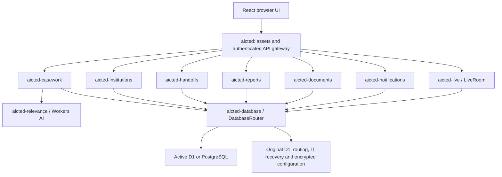

# AICTED

React / TypeScript complaint workspace backed by Cloudflare D1/PostgreSQL and focused Cloudflare Workers.

## Run locally

Requires Node 22.12+ and authenticated Wrangler (installed globally on this machine).

```sh
npm ci
npm run dev
```

Vite serves the frontend on port 5173 (or the next available port) and proxies
`/api` to the local Worker on 8787. The web entry and all focused private Workers run together.
`npm run dev` applies local migrations. This checkout already has local secrets
and demo records. No remote database is used by local development.

For a fresh checkout, create the same random `INTERNAL_SECRET` in `.dev.vars`,
every `workers/*/.dev.vars`. Services that encrypt credentials also need the same `CONFIG_KEY` (64 hexadecimal characters). These files are
ignored. Demo seeds (including `seed/separate-test-logins.sql`) and provisioning tools are deliberately local and ignored;
obtain them from the project maintainer if you need another development database.
Never copy production records into the public demo dataset.

```sh
npm run build
```

This checks both frontend and Worker TypeScript and produces the static `dist/`.
`npm run preview` previews frontend assets only; use `npm run dev` for the API.

## Test login

| Test designation                 | ID   | Password |
| -------------------------------- | ---- | -------- |
| Test Official                    | 0000 | 111111   |
| Test Manager                     | 0001 | 111111   |
| Institution tab (no designation) | 0002 | 111111   |

These fixed identities authenticate only the demo dataset. The manager has a
reporting team, review queues and team workload; the official has personal assignments.
Other demo officials have no passwords and cannot log in directly. There is no
impersonation or workspace identity switch. IT is separated at `/it`, reached by
the footer link, and uses ID 0000 / password 111111 for its isolated demo.
Workspace HTML routes and API requests both require a server-validated HttpOnly
session cookie; portal roles are enforced server-side.
AI inference is blocked for all demo personas. Demo case, comment and message
limits prevent unbounded storage growth. Changes persist and are visible to other testers.

## Implemented workflow

- My Work, searchable/filterable Cases, manager team workload and intake review.
- Proposed case registration; manager approval, return, rejection and resubmission.
  No official self-approval; institution submissions go to an explicitly configured intake manager. Receipt dates survive review.
- Timestamped append-only case boards with comments, status updates, escalation,
  disposal, reopening and manager-approved cross-bureau ownership handoffs. Complete history is paginated and new events retain immutable actor and ownership snapshots. Escalation has a red text badge.
- Two-stage cross-Bureau coordination: requester’s manager, then receiving manager.
  Only the selected official gains access. Pending details remain restricted;
  access can be revoked. Shared access does not grant disposal/transfer authority.
- Searchable read-only institution directory for officials; active and past scoped
  cases, handling Bureaus and detailed ownership/coordination history in each board.
- Messages addressed by official ID/designation. Case references require access
  on both sides; revoked references are redacted on subsequent reads.
- Complete scoped report aggregates, receipt-date/institution filters, ageing, bureau workload, event-based monthly/quarterly disposal and transfer figures, and streamed CSV export. Legacy events without historical ownership are not assigned invented owners.
- Separate IT portal with Accounts, Institutions, Email and Database sections.
  Officials and managers use their own workspace; managers have a Team sidebar entry.
- Searchable official/manager fields use loaded results, a 500ms debounce, bounded
  full-text directory searches and five-minute browser caches. No polling.
- Database configuration shows the active name/type and allows configuration
  of another D1 or PostgreSQL connection, with schema setup, connection checks, data transfer and activation.
  The help tooltip links to `/postgres-spec.html` and downloadable target SQL.
- Private English embedding suggestions for production officials, optional translation
  to English first, seven-day cache and ten uncached requests per official/day.
  Original case text stays unchanged; translation is shown separately for review.
  The deployed BGE model passed a bounded real inference test. The public demo cannot exercise AI.

Production accounts and reporting lines should follow verified office orders. Create the first production administrator through the protected setup form described below; no provisioning script is required.
Institution accounts, intake managers and institution records are configured through Administration Panel → Institutions. Password recovery supports all three portals after a verified email provider is configured. Contact email settings alone do not activate a mail provider.
The application starts on `aicted-workspace`. IT can configure and activate another
D1 database or a public TLS PostgreSQL 16+ connection through Database settings.
See the on-site Setup guide and `/postgres-spec.html`. A saved connection is inactive
until explicitly activated. The original D1 remains the control/recovery store.

## Cloudflare architecture and deployment

| Worker                 | Responsibility                                                                     | Exposure                                    |
| ---------------------- | ---------------------------------------------------------------------------------- | ------------------------------------------- |
| `aicted`               | React assets, sessions, same-origin API entry, rate limits                         | Public                                      |
| `aicted-casework`      | Scoped D1 cases, sharing, messages and IT operations                               | Service binding only                        |
| `aicted-relevance`     | Translation and embedding inference                                                | Service binding only                        |
| `aicted-notifications` | Recovery mail, case updates and scheduled reminders                                | Service binding only                        |
| `aicted-institutions`  | Institution authentication, own-case intake/history and institution administration | Service binding only                        |
| `aicted-handoffs`      | Receiving-manager approval and cross-bureau ownership changes                      | Service binding only                        |
| `aicted-reports`       | Scoped server aggregates and complete streamed CSV export                          | Service binding only                        |
| `aicted-live`          | Targeted refresh signals through hibernating WebSockets                            | Service binding + SQLite Durable Object     |
| `aicted-documents`     | Restricted Google Drive case-folder metadata                                       | Service binding only                        |
| `aicted-database`      | Database adapters, serialized routing and verified transfers                       | Service binding + one SQLite Durable Object |

All private calls use the same `INTERNAL_SECRET`, stored as a Cloudflare secret; never
use a `VITE_` variable for it. Secrets are not committed. Private Workers have
`workers_dev` and preview URLs disabled. Public requests cannot pass their own actor
or internal secret through the web Worker. Sessions are opaque hashed tokens,
HttpOnly / SameSite=Lax cookies, eight-hour expiry, and Secure on HTTPS.

Dedicated database: `aicted-workspace`. Migrations are versioned under
`database/migrations`; helper/seed files are intentionally ignored.

```sh
wrangler d1 migrations apply DB --remote
wrangler deploy --config workers/relevance/wrangler.jsonc
wrangler deploy --config workers/live/wrangler.jsonc
wrangler deploy --config workers/database/wrangler.jsonc
wrangler deploy --config workers/notifications/wrangler.jsonc
wrangler deploy --config workers/institutions/wrangler.jsonc
wrangler deploy --config workers/handoffs/wrangler.jsonc
wrangler deploy --config workers/reports/wrangler.jsonc
wrangler deploy --config workers/documents/wrangler.jsonc
wrangler deploy --config workers/casework/wrangler.jsonc
npm run build
wrangler deploy
```

Configure `INTERNAL_SECRET` on each Worker before deploying, using Wrangler secret
input or the Cloudflare dashboard. Deploy private services before the web entry.
The Git-connected main project can keep build command `npm run build` and deploy
command `npx wrangler deploy`. Changes to private Workers require their separate
deploy commands above; the main project's build does not deploy them automatically.

Native SPA fallback is in `wrangler.jsonc`. Do not restore `/* /index.html 200`
in `_redirects`; it creates a redirect loop with Workers static asset routing.

## Query budget and verification

Normal workspace updates use authenticated hibernating WebSockets: a bounded, targeted “changed” signal refreshes the recipient’s scoped API data. Private comments do not signal institution clients. There is no periodic case polling; foreground/reconnection refresh handles missed signals. Database-transfer status polls only while a transfer is active.

Search uses debounce, bounded caches and indexed queries. Cases and overlaps use keyset pages of 25, action history pages of 30 and institution cases pages of 20. Reports aggregate the full permitted dataset on the server; CSV streams pages of 200. Reminder thresholds come from the same runtime setting in dashboard counts, filters and email scheduling. Additional indexes cover event-based performance.

Validation includes frontend/Worker type checks and production build; API integration across four roles; public/private history, recovery, approvals, reviewed escalation/cancellation, coordination, cross-bureau handoffs, account invalidation, over-600-row reports/CSV, paginated histories and actual WebSocket privacy checks. PostgreSQL schema and these core workflows run against a PostgreSQL engine in isolated tests. Browser checks cover laptop/mobile layouts, report drawing and workspace bounds. Real email inbox delivery and an externally hosted PostgreSQL TLS connection require the administrator’s provider credentials.

## Production setup

To create the first real administrator:

1. Open `/it` and sign in with the existing demo administration login (ID `0000`, password `111111`). This grants demo access only.
2. Open **Server setup**, then **Create administrator account**.
3. Read the setup code locally from `seed/bootstrap-token.txt`. Keep its contents private; do not paste it into chat, Git, screenshots or these docs.
4. Enter the code, a new unique production ID, your name, email and a password of at least 12 characters. Submit the form.
5. Sign out and return to `/it` using the new ID and password. The new account uses the production dataset.

Setup requires an authenticated administration session AND the secret bootstrap code. It is one-time and atomic; a demo login alone cannot create a production administrator. If setup is already complete, the creation link is unavailable. If the local setup-code file is missing, the deployment owner must securely configure a replacement `BOOTSTRAP_TOKEN` on the public Worker; existing secret values cannot be retrieved through the website. Remove that Cloudflare secret after successful setup.

IT can create official/manager accounts, assign reporting lines and email addresses,
configure the canonical bureau catalogue, site URL, session duration and reminders.
Accounts are active only after IT creates them; choosing a designation grants no authority.

Email settings support Resend and SendGrid, separate recovery/update senders,
reply-to and support addresses, opt-in delivery and daily attempt caps. Verify sender
domains with the chosen provider, paste its API key, save settings, then send a
verification message to the signed-in IT account. Keys are encrypted with AES-GCM
and the Cloudflare `CONFIG_KEY` secret. Normal settings responses contain only
metadata; revealing a key requires an explicit audited request. Demo accounts cannot
store production credentials, reveal secrets, or send mail. Do not rotate CONFIG_KEY
without decrypting/re-encrypting stored secrets first.

The private `aicted-notifications` Worker handles recovery and queued case updates;
a 15-minute cron schedules bounded reminders. Accepted means accepted by the email
provider, not guaranteed inbox delivery. Database connections support real activation; saving alone does not switch traffic.

Official autocomplete uses two-character minimum, 500 ms debounce, five-minute
bounded client cache, concurrent-request deduplication, and indexed FTS results limited
to 20. The workspace no longer loads the entire official directory at startup.

The login map remains entirely local SVG/vector data, hidden on phones, with reduced
motion support. The new AICTE mark is a transparent minimalist SVG adaptation.
Asset sources and licences: [docs/ASSETS.md](docs/ASSETS.md).
Workflow authority assumptions: [docs/WORKFLOW.md](docs/WORKFLOW.md).

## Live database switching

The database Worker owns a singleton SQLite-backed Durable Object. Active routing
is loaded once per object activation; application queries do not poll the D1 control
registry. It serializes database batches and pauses application access during a
transfer. Request generation checks prevent a request that read the old database
from writing to the new one. Transactions use native D1 batches or PostgreSQL
transactions; values remain bound parameters. Alternate D1 databases use scoped
Cloudflare API credentials, avoiding manual Worker binding changes.

Copy uses indexed keyset pages of 20 rows, resumable alarms, canonical row hashes,
and deferred restoration of reporting managers. A destination must be initialized
and empty (apart from reference catalogues). Failed copies leave the source active
and allow explicit removal of only the incomplete destination application schema.
Prepared mode uses existing destination records and requires the current IT account.
The previous connection is retained; reverting does not merge post-switch writes.

IT sessions, recovery identities, delivery settings, encrypted connection credentials
and routing history remain in the original D1. Retain its binding and CONFIG_KEY.
The demo IT login cannot alter real connections or inspect production connection
metadata. Test accounts cannot consume inference or email delivery.

Officials’ reports measure their own assigned cases. Managers’ reports measure their
reporting team. IT can explicitly grant bureau-wide reports to a Bureau Head / Cell
In-charge. Designations never automatically grant access. Shared case access and
personal submissions are not silently counted as another official’s workload.

The alternate-D1 switch was exercised against a temporary database: initialization,
schema/trigger checks, verified copy, activation and prepared rollback passed. The
temporary database was deleted afterward. Live portal routing remains on its original
D1. Server-maintained schemas live in `workers/database/schema.ts`; the PostgreSQL
download is `public/postgres/schema.sql`. The unused R2 upload service code has been
removed; legacy document metadata remains in the database for safe transfer compatibility.

Manager work is divided into Overview, Approvals, Team workload and My cases.
Approved personal/team cases can be assigned through a searchable team-member form;
the server enforces reporting-team membership and records the assignee in case history.
Cases navigation contains the register, assignments, submissions/review, coordination
and overlaps. Assigned cases are approved work; submissions have not been admitted.
Administrator setup pages and endpoints require an existing IT session in addition
to the one-time setup code. Login pages contain no setup link.

## Institution cases and visibility

Administration provisions each representative against a verified institution and configures the receiving manager for every offered bureau. Institution sign-in uses the Institution tab; account IDs are separate from official IDs. Representatives can register, follow major events, revise returned submissions, request escalation/cancellation and review disposed outcomes. Staff approve requests; institutional requests never silently close or escalate a case.

Only institution-originated cases are visible in that portal. Internal cases at the same institution stay confidential. Staff comments and Drive links are private unless the author explicitly chooses institution visibility. Formal update text is sanitized unless marked public. Reviews and requests remain in the append-only history. Drive sharing is manual and independent of portal permissions; no R2 account is required.

Cross-bureau handoff changes ownership only after the receiving official’s manager approves. The source manager must already control the case. Former responsible officials retain a read-only history grant; they lose action authority. Coordination remains a separate two-stage selected-official access workflow.

## Request flow and trust boundaries



The browser talks only to the public gateway. It validates session cookies, checks origin on mutations, applies rate limits, and supplies the authenticated actor to private services. Each private service checks the shared server secret and enforces its own role/case scope. Client-supplied actor headers cannot choose an identity. Private service bindings are not public API URLs.

Case registration records the original receipt, then routes the submission for manager review. Coordination shares selected-official access after two approvals; a handoff changes ownership after receiving-manager approval. Institution history exposes formal updates and explicitly public comments only. Reports use a separate workload scope; a shared case does not automatically count as personal work.

DatabaseRouter serializes application batches and coordinates resumable copy/verification. Original D1 stays the control/recovery store when the active application database changes. LiveRoom sends targeted refresh hints rather than case contents; clients fetch authorized data again. Notifications handle provider requests and scheduled reminders. Document files remain in Google Drive, outside SQL backups and portal authorization.

Workers AI uses `@cf/baai/bge-small-en-v1.5` for English embeddings and `@cf/meta/m2m100-1.2b` for optional translation. Suggestions require an explicit click by a production official. Demo inference is blocked, cached results are reused, and uncached calls have a per-official daily quota. The institution portal currently uses manual tags.

## Security status and basic injection protection

This is a source-level assessment, not a penetration-test certification. No additional tests were run for this documentation update.

- **SQL injection:** application values use D1 bound parameters or PostgreSQL positional parameters. Dynamic table/column names used by database transfers come from internal schema catalogues, not complaint text. PostgreSQL's `unsafe` method receives bound values separately; its name does not mean values are concatenated into SQL. The private database service accepts internal SQL and must remain inaccessible to browsers/untrusted Workers.
- **HTML/script injection:** React renders complaint/comment strings as text. The UI does not intentionally evaluate submitted HTML or JavaScript. Static asset headers include a self-only script policy, blocked object embedding, frame restrictions and MIME sniffing protection. These controls reduce risk; they do not prove every future rendering change safe.
- **Authentication:** passwords use salted PBKDF2-SHA256; opaque session tokens are hashed in storage. Cookies are HttpOnly, SameSite=Lax and Secure over HTTPS. Session expiry is configurable. Reset links expire, are single-use and revoke existing sessions.
- **Authorization:** role checks and scoped case queries run on the server. Institutions cannot use staff endpoints; demo and production records are separated. A designation selected at login does not assign permissions.
- **Request abuse:** same-origin mutation checks, login/write rate limits, request-size limits, bounded paging and inference/email quotas provide basic defenses. They are not complete DDoS protection or an organization-wide resource budget.
- **Secrets:** runtime secrets stay in Cloudflare secrets; saved provider/database credentials are encrypted with AES-GCM. No secret values belong in this repository. Preserve `CONFIG_KEY` securely and rotate deliberately.

Important remaining hardening: administration has no MFA, password hashing currently uses 100,000 PBKDF2 iterations, login throttling is IP-based rather than account-wide, and there has been no independent security audit. Administrators are trusted to configure external database hosts and credentials. A compromised administrator or shared internal secret has a broad impact. Drive sharing and third-party sender security remain separate responsibilities. Do not describe the portal as attack-proof.

Public documentation mirror: [docs/PROJECT_README.md](docs/PROJECT_README.md). Both copies are tracked; update them together. Private audit notes, seeds and local helpers remain ignored.
